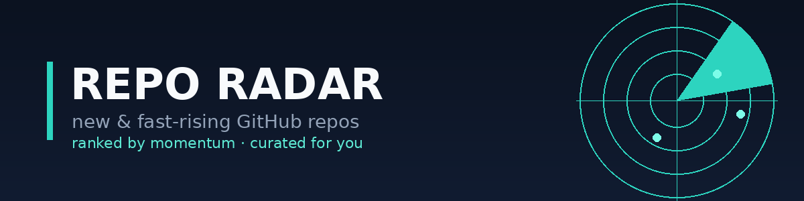

# 🛰️ Repo Radar — 2026-11-08

_9 new · last 120d · ≥150⭐ · momentum + 7-day risers._

## AI agents & LLM tooling

1. **[JosssphZhou/poki](https://github.com/JosssphZhou/poki)** — ⭐ 508 · 210.7/day · JavaScript · since 2026-11-05
   > Let AI agents operate a real iPhone. Local MCP server and agent, no jailbreak, no extra hardware.
2. **[Revivedx/SavageWindRecomp](https://github.com/Revivedx/SavageWindRecomp)** — ⭐ 3,438 · 154.1/day · C · since 2026-10-16
   > Work-in-progress static recompilation of The Legend of Zelda: Breath of the Wild (Switch, v1.9.0) for Windows and Linux. Bring your own…
3. **[alchaincyf/deepseek-harness-orange-book](https://github.com/alchaincyf/deepseek-harness-orange-book)** — ⭐ 1,416 · 16.5/day · HTML · since 2026-08-14
   > DeepSeek Harness橙皮书《从开机到拆开》：完整系统提示词、129行启动清单、三份原始会话日志——官方文档没有的一手实测。PDF/EPUB/HTML免费下载

## Multimodal AI

1. **[Lechoung-J/reelpack-alpha](https://github.com/Lechoung-J/reelpack-alpha)** — ⭐ 152 · 8.8/day · Python · since 2026-10-21
   > Reelpack — 给 AI 的视频理解引擎 / The Video-Understanding Engine for AI · License: FSL-1.1-MIT

## Marketing & analytics tech

_Nothing new this run._

## Web/app dev stack

_Nothing new this run._

## Self-development & productivity

_Nothing new this run._

## Claude & agent design craft

1. **[bangtutorial/bang-motion](https://github.com/bangtutorial/bang-motion)** — ⭐ 1,571 · 24.9/day · HTML · since 2026-09-05
   > Agent skill for browser motion graphics — openers, promos, bumpers, kinetic typography, and five explainer styles that move like video, not…
2. **[tencentmusic/modus](https://github.com/tencentmusic/modus)** — ⭐ 213 · 9.7/day · Python · since 2026-10-17
   > 从需求澄清到可信交付的 Agent 编程 Harness 工程框架
3. **[2youg1/sprawling-agents](https://github.com/2youg1/sprawling-agents)** — ⭐ 108 · 1.4/day · Rust · since 2026-08-22
   > 🏙️ A city of AI agents on your machine where nothing is hidden: prompts are plain files you own, and every context is a line in a…

## Community & social media management

_Nothing new this run._

## Customer-service AI agents

_Nothing new this run._

## Meta inbox & omnichannel AI agents

_Nothing new this run._

## Wildcard — adjacent leverage

1. **[alchaincyf/huashu-chrome](https://github.com/alchaincyf/huashu-chrome)** — ⭐ 576 · 7.8/day · JavaScript · since 2026-08-26
   > 让任何 AI agent 操控你自己的 Chrome——带着全部登录态。MCP + Chrome 扩展，Claude Code / Codex / Cursor / Gemini CLI 通用。

## Ads & paid growth

_Nothing new this run._

## Short-form video & content production

1. **[riecodes/free247editor](https://github.com/riecodes/free247editor)** — ⭐ 170 · 7.3/day · TypeScript · since 2026-10-15
   > Free, open-source personal AI video editor for Claude. Drop in a raw video, say "edit this", give notes in plain words.

## E-commerce & Shopify

_Nothing new this run._

## Brand systems & creative ops

_Nothing new this run._

---

_radar.py · tune `interests.yml` to retune._
